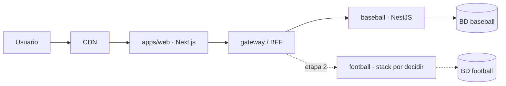

# Arquitectura de la plataforma

> Este documento es **independiente del lenguaje**. El stack de cada deporte está en `docs/deportes/<deporte>/adr/XX-0001-stack-backend.md`.
> Depende de: [ADR-0001](adr/0001-servicio-por-deporte.md), [ADR-0002](adr/0002-stack-por-deporte.md), [ADR-0003](adr/0003-frontend-react.md).

## Vista de sistema (objetivo)



En la etapa 1 el gateway es opcional: `apps/web` puede llamar directamente al servicio de béisbol.

## Servicios de deporte

### Contrato común
Todo servicio cumple el contrato de [ADR-0002](adr/0002-stack-por-deporte.md) §3: OpenAPI 3.1, RFC 9457, `/health`, Docker, BD propia, OpenTelemetry. El frontend y el gateway solo dependen de ese contrato.

### Organización interna: hexagonal (ports & adapters)
Se aplica en cualquier lenguaje; los nombres de carpeta se adaptan a las convenciones del stack.

```
domain/          Entidades, value objects, reglas y cálculos estadísticos. Código puro, 100% testeable.
application/     Casos de uso. Define puertos (interfaces de repositorios, proveedores externos).
infrastructure/  Adaptadores: persistencia, HTTP, importadores de datos.
```

Reglas de dependencia: `infrastructure → application → domain`. Nunca al revés.

### Procesos: API y worker (diferido)
Por ahora cada servicio es **un solo proceso** (la API). Si más adelante un deporte incorpora análisis avanzado, podrá desplegarse como **dos procesos del mismo código**: `api` (consultas y registro) y `worker` (jobs por lotes). Ambos usan el mismo `domain`, así cada fórmula existe una sola vez.

## Flujo de datos
1. **Escritura**: se registran los eventos atómicos del deporte (béisbol: apariciones al plato — [ADR-BB-0002](deportes/beisbol/adr/BB-0002-jugada-como-fuente-de-verdad.md)).
2. **Derivación**: el dominio calcula las líneas de estadística a partir de los eventos.
3. **Lectura**: los agregados por temporada/carrera se sirven precalculados y se recalculan cuando cambia un partido.
4. **Análisis (diferido)**: sabermetría y análisis avanzado quedan fuera de alcance por ahora; cuando se retomen, un worker las calculará y las escribirá en tablas que la API solo lee.

## API
- REST + JSON, versionada por ruta: `/api/v1/<deporte>/...`.
- Contrato primero: `services/<deporte>/openapi.yaml`.
- Paginación por cursor en listados.
- Endpoints de cada deporte: en su README (ej. [béisbol](deportes/beisbol/README.md)).

## Frontend
Una sola app React ([ADR-0003](adr/0003-frontend-react.md)), con un módulo por deporte y clientes tipados generados desde cada OpenAPI. No calcula estadísticas.

## Despliegue
- Etapa 1: contenedores en un PaaS + BD gestionada; frontend detrás de un CDN.
- Etapa 2+: contenedores serverless (Cloud Run / Azure Container Apps / ECS Fargate), un servicio por deporte, más el gateway.
- Caché: CDN + ISR de Next.js, headers HTTP en `GET`, agregados precalculados en BD.

## Calidad
- Tests unitarios del dominio con datos de partidos reales (golden files) en `tests/fixtures/`.
- Tests de integración con base de datos real en contenedor.
- Cobertura objetivo del dominio: ≥ 90%.

## Atributos no funcionales ❓
- Volumen esperado (partidos/temporada, usuarios concurrentes).
- Latencia objetivo de consultas de líderes (ej. p95 < 300 ms).
- Nube elegida y presupuesto.
