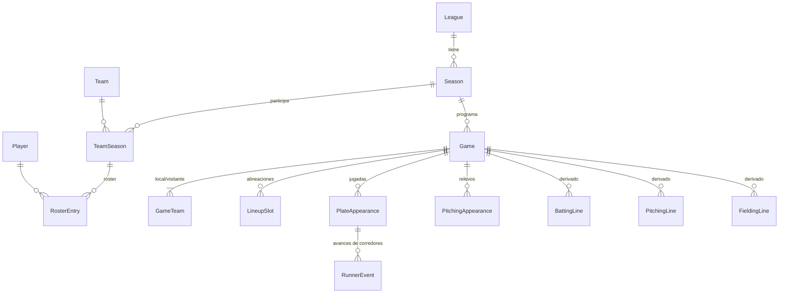

# Modelo de dominio — Béisbol

> Depende de [ADR-BB-0002](adr/BB-0002-jugada-como-fuente-de-verdad.md). Nombres en inglés (código), descripción en español.

## Diagrama

## Entidades

### Organización
- **League**: `id`, `name`, `level` (MLB, AAA, amateur…), `rules: LeagueRules`.
- **LeagueRules** (value object, ⚙️ en reglas-negocio): `innings_per_game`, `designated_hitter`, `extra_inning_runner`, `batting_qualifier_pa_per_game` (3.1), `pitching_qualifier_ip_per_game` (1.0), `tiebreakers[]`.
- **Season**: `id`, `league_id`, `year`, `start_date`, `end_date`, `rules_override?`.
- **Team**: `id`, `name`, `abbreviation`, `city`.
- **TeamSeason**: equipo dentro de una temporada (división, manager).
- **Player**: `id`, `first_name`, `last_name`, `birth_date`, `bats` (R/L/S), `throws` (R/L).
- **RosterEntry**: `player_id`, `team_season_id`, `jersey_number`, `primary_position`, `from`, `to`.

### Partido
- **Game**: `id`, `season_id`, `scheduled_at`, `status` (SCHEDULED, IN_PROGRESS, FINAL, SUSPENDED, POSTPONED), `scheduled_innings`, `source` (PLAY_BY_PLAY | MANUAL_BOXSCORE).
- **GameTeam**: `game_id`, `team_season_id`, `side` (HOME/AWAY), `runs_by_inning[]`, `runs`, `hits`, `errors`.
- **LineupSlot**: `game_id`, `team`, `batting_order` (1–9), `player_id`, `position`, `entered_at_pa?` (sustituciones).
- **PitchingAppearance**: `game_id`, `player_id`, `order`, `entered_at_pa`, `inherited_runners`, `decision?` (W/L/SV/HLD/BS).

### Evento (fuente de verdad)
- **PlateAppearance**: `id`, `game_id`, `inning`, `half` (TOP/BOTTOM), `sequence`, `batter_id`, `pitcher_id`, `outs_before`, `bases_before` (bitmask), `result: PAResult`, `balls`, `strikes`, `outs_on_play`, `rbi`, `fielders[]` (ej. `6-4-3`).
- **PAResult** (enum): `SINGLE, DOUBLE, TRIPLE, HOME_RUN, WALK, INTENTIONAL_WALK, HIT_BY_PITCH, STRIKEOUT, STRIKEOUT_REACHED, GROUND_OUT, FLY_OUT, LINE_OUT, POP_OUT, DOUBLE_PLAY, TRIPLE_PLAY, FIELDERS_CHOICE, REACHED_ON_ERROR, SAC_FLY, SAC_BUNT, CATCHER_INTERFERENCE`.
- **RunnerEvent**: `runner_id`, `from_base`, `to_base` (o OUT / SCORED), `reason` (ON_PLAY, STOLEN_BASE, CAUGHT_STEALING, WILD_PITCH, PASSED_BALL, BALK, ERROR), `earned: bool`, `charged_pitcher_id`.

### Derivados (proyecciones, no se editan a mano salvo `MANUAL_BOXSCORE`)
- **BattingLine**: por jugador y partido — `PA, AB, R, H, 2B, 3B, HR, RBI, BB, IBB, K, HBP, SF, SH, SB, CS, GIDP`.
- **PitchingLine**: `outs_recorded, H, R, ER, BB, IBB, K, HBP, HR, BF, pitches, WP, BK, decision`.
- **FieldingLine**: por jugador, partido y posición — `PO, A, E, DP`.
- **SeasonBattingStats / SeasonPitchingStats**: suma de líneas + tasas calculadas (RN-GEN-001).

## Invariantes del dominio
- `0 ≤ outs_before ≤ 2`; tras la jugada, outs ≤ 3.
- `ER ≤ R` por lanzador (RN-PIT-004).
- Un juego FINAL cumple RN-JUE-002.
- Un jugador solo puede estar en un `LineupSlot` activo por juego.
- Las tasas nunca se persisten como fuente; se calculan o se cachean en agregados recalculables.

## Value objects sugeridos
`InningsPitched` (desde outs), `BattingAverage`/`Rate` (numerador, denominador → `null` si 0), `BaseState`, `Count` (bolas/strikes).
